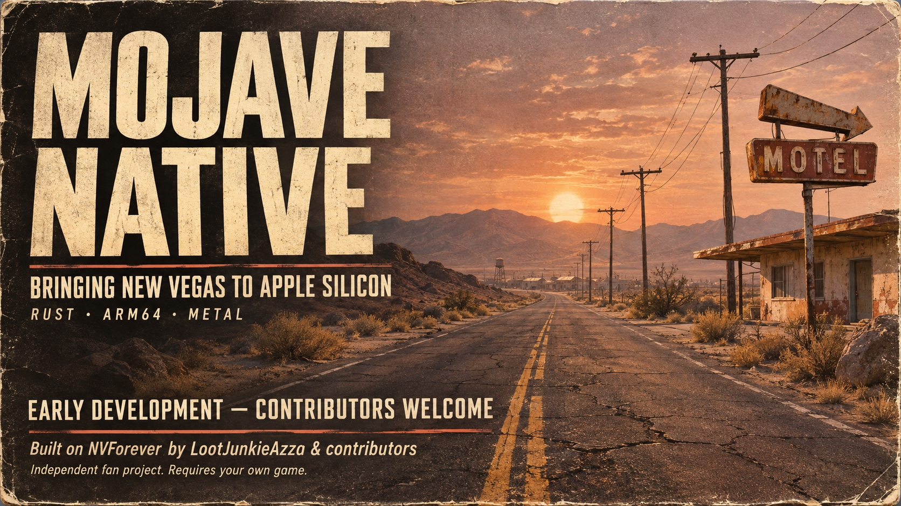

# Mojave Native

**New Vegas on Apple Silicon. Built on NVForever by LootJunkieAzza and contributors.**

Mojave Native is an independent community effort to bring [NVForever's Rust engine](https://github.com/LootJunkieAzza/NVForever) to native 64-bit ARM64 macOS with Metal rendering. First: a practical, playable Mac preview using the player's own New Vegas and DLC files.

NVForever is the engine, created by **LootJunkieAzza and the NVForever contributors**. This project adapts and integrates their work for Mac; it does not claim to have created their engine. Suitable platform changes should go upstream.

## The road ahead

1. **Native Mac first:** straightforward setup, responsive first/third-person play, sound, save/load and measured performance.
2. **Nuclear Sunset Hardercore + Long 15:** bring the selected visual/gameplay experience to the native engine, including TTW support and a feature-level compatibility record.
3. **A living multiplayer world:** ultimately, a self-hostable server for an initial 5–10 Mac/Windows players, with hardcore survival, settlements, faction territories, trade, production and strategic resource management, played in first/third person.

The later phases are goals, not released features. See [ROADMAP.md](ROADMAP.md) and [STATUS.md](STATUS.md).

## Current state — 7 November 2026

- A native Mach-O ARM64 release executable has built locally.
- Earlier sessions exercised parts of world rendering and movement. The newest candidate still needs focused player-facing acceptance.
- Two shared compiler fixes improved a fixed 337-input ScriptRunner corpus from 316 to 319 successful compilations, with no new failures. This is compilation evidence, not a percentage of working mods.
- Full playthrough, full TTW/Nuclear Sunset compatibility, Long 15 gameplay and Mac/Windows multiplayer have not been demonstrated here.
- An experimental source-only snapshot is included; its fresh external build still needs reproduction. See [BUILD-MAC.md](BUILD-MAC.md). There is no public playable release yet.

## Help build it

Looking for Rust/Bevy developers, Metal/wgpu contributors, macOS packaging help and Apple Silicon testers. Start with one bounded task in [CONTRIBUTING.md](CONTRIBUTING.md). The next useful result is a reproducible playable Mac route.

## Credits

| Project | Creators | Role |
| --- | --- | --- |
| [NVForever](https://github.com/LootJunkieAzza/NVForever) | **LootJunkieAzza and contributors** | Rust engine and foundation |
| [Nuclear Sunset](https://nuclearsunset.com/docs/main/credits/) | **DarkSolarLegend, OrgasmicSneeze, DoktorAkcel, Lime, FinalCatalyst, TheBooher**, original mod authors and community | Future Hardercore integration target |
| [Long 15 - NCR Expansion](https://www.nexusmods.com/newvegas/mods/94306) | **Long 15 Team / ToxicWhiteout** | Future expansion compatibility target |
| [Tale of Two Wastelands](https://mod.pub/ttw/133-tale-of-two-wastelands) | **TTW team and contributors** | Content conversion required by Nuclear Sunset |

Full credits and original links: [CREDITS.md](CREDITS.md). Every creator keeps credit for their code, art, writing, audio and other work.

## Ownership and licensing

Players supply their own lawfully acquired game and DLC. TTW/Nuclear Sunset also require the appropriate owned Fallout 3 data. Game files, mod archives, converted assets, credentials and private saves are not bundled. Mod permissions remain separate; credit is not redistribution consent.

NVForever code is **GPL-3.0-or-later**. Preserve its notices and provide the corresponding source for distributed covered binaries. Clean-room rules apply; no leaked/decompiled game implementation is imported. See [LICENSE](LICENSE) and [UPSTREAM-LEGAL.md](UPSTREAM-LEGAL.md).

Independent fan project. No endorsement by NVForever, Nuclear Sunset, Long 15 Team, Bethesda, Obsidian or Apple is claimed. Promotional artwork provenance is recorded in [assets/README.md](assets/README.md).
