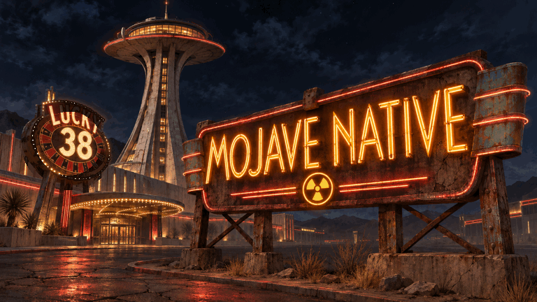
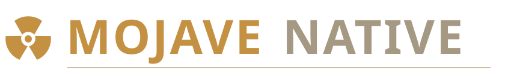
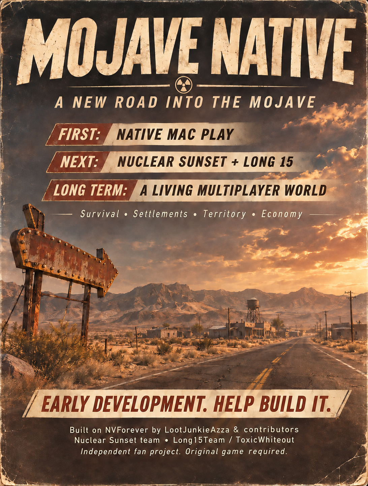

  

<b>New Vegas' engine, reimplemented in Rust. Bringing it to native 64-bit Mac.</b> ARM64 · Metal · Open source

Built on <a href="https://github.com/LootJunkieAzza/NVForever"><b>NVForever</b></a> by <b>LootJunkieAzza and contributors.</b>

  <a href="BUILD-MAC.md"><b>Build the source</b></a> &nbsp; / &nbsp;
  <a href="CONTRIBUTING.md"><b>Help build it</b></a> &nbsp; / &nbsp;
  <a href="ROADMAP.md"><b>Roadmap</b></a> &nbsp; / &nbsp;
  <a href="STATUS.md"><b>Development status</b></a>

Early development · Experimental source snapshot · No playable release yet

---

**Mojave Native** brings **NVForever's Rust reimplementation of the Fallout: New Vegas engine** to **native 64-bit ARM64 macOS**, with **Metal rendering**. The renewed engine is the foundation; players supply their own original game and DLC data. Our first goal is a Mac version that is straightforward to build, set up and play, with responsive first- and third-person controls, sound and reliable save/load.

**Built on [NVForever](https://github.com/LootJunkieAzza/NVForever) by LootJunkieAzza and the NVForever contributors.** Their Rust engine is the foundation. Mojave Native's Mac adaptations are separate work, and suitable improvements should go upstream.

## What we're building

| **01 · Native Mac** | **02 · A richer Mojave** | **03 · A living world** |
| :--- | :--- | :--- |
| A playable Apple Silicon preview on the **rebuilt Rust engine**, measured performance, sound and save/load. | **Nuclear Sunset Hardercore**, TTW and **Long 15 - NCR Expansion**, with native feature compatibility. | Self-hosted **5–10-player Mac/Windows** survival, settlements, territory, production and trade. |
| **Current focus** | **Integration target** | **Long-term ambition** |

The later phases are goals, not released features. Strategy and resource management should matter, while you explore and act through a first- or third-person character.

**Vehicles and living traffic are also on the roadmap:** future native integration of **[New Vegas Drivables](https://into-the-rough.github.io/new-vegas-drivables/)** by **Into-The-Rough / Oliver Swanick Productions**, including drivable vehicles and NPC road traffic. The author's current release target is **December 2026**. Our integration follows its release and requires native compatibility work; it is not installed or verified here. [Vehicle plan →](ROADMAP.md#2a--vehicles-and-npc-traffic)

## Help shape the next build

We need **Rust / Bevy**, **Metal / wgpu**, **macOS packaging** and **Apple Silicon testing** contributors. Pick one small, verifiable task: reproduce the exported source build, improve display/input behavior, check audio and save/reopen/load, or measure one gameplay route.

**[Start contributing →](CONTRIBUTING.md)** &nbsp; **[Open tasks →](https://github.com/LeaderChef/mojave-native/issues)**

<b>What has actually been verified?</b>

Updated 7 November 2026:

- A local **Mach-O ARM64 release executable** built successfully.
- Earlier sessions exercised parts of world rendering and movement. Focused player acceptance for the newest candidate is still incomplete.
- Two shared compiler fixes improved a fixed **337-input** ScriptRunner corpus from **316 to 319** successful compilations, without new failures. Compilation is not a mod-compatibility percentage.
- This new **source-only export needs fresh build reproduction**. It is not a verified public playable release.
- Full playthrough, full TTW/Nuclear Sunset compatibility, Long 15 gameplay and Mac/Windows shared sessions have not been demonstrated here.

**[Full status](STATUS.md)** · **[Build instructions and limits](BUILD-MAC.md)** · **[Technical background](RESEARCH.md)**

## The road ahead

  

## Built on a community's work

| Project | Original creators |
| :--- | :--- |
| **[NVForever](https://github.com/LootJunkieAzza/NVForever)** — our engine foundation | **LootJunkieAzza and contributors** |
| **[Nuclear Sunset](https://nuclearsunset.com/docs/main/credits/)** — Hardercore integration target | **DarkSolarLegend, OrgasmicSneeze, DoktorAkcel, Lime, FinalCatalyst, TheBooher**, original mod authors and community |
| **[Long 15 - NCR Expansion](https://www.nexusmods.com/newvegas/mods/94306)** — expansion target | **Long 15 Team / ToxicWhiteout** |
| **[Tale of Two Wastelands](https://mod.pub/ttw/133-tale-of-two-wastelands)** | **TTW team and contributors** |
| **[New Vegas Drivables](https://into-the-rough.github.io/new-vegas-drivables/)** — future vehicles/traffic target | **Into-The-Rough / Oliver Swanick Productions** |

**[Full credits and original project links →](CREDITS.md)**

<b>Your game. Original creators' rights.</b>

Bring your own lawfully acquired New Vegas and DLC data. TTW/Nuclear Sunset also require the appropriate owned Fallout 3 data. Game files, mod archives, converted assets, credentials and private saves are not bundled. Credit does not grant permission to redistribute another creator's work.

NVForever code remains **GPL-3.0-or-later**; retain its notices and provide corresponding source for distributed covered binaries. Clean-room development rules apply. See [LICENSE](LICENSE), [UPSTREAM-LEGAL.md](UPSTREAM-LEGAL.md), [source origin](SOURCE-ORIGIN.json) and [artwork provenance](assets/README.md).

Fallout: New Vegas was developed by Obsidian Entertainment; Fallout names/content remain with Bethesda and their respective rights holders. Independent fan effort, with no endorsement by NVForever, Nuclear Sunset, Long 15 Team, Bethesda, Obsidian or Apple claimed.

