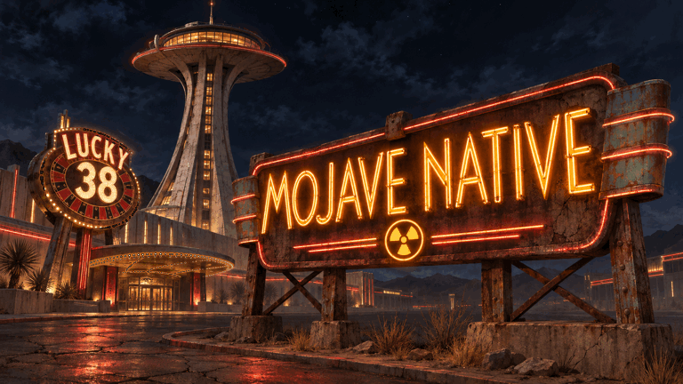

  

<b>New Vegas' engine, reimplemented in Rust. Bringing it to native 64-bit Mac.</b>

Built on <a href="https://github.com/LootJunkieAzza/NVForever"><b>NVForever</b></a> by <b>LootJunkieAzza and contributors.</b> ARM64 · Metal · Open source

## The project

**Mojave Native** is the Mac adaptation of **NVForever's Rust reimplementation of the Fallout: New Vegas engine**. Our goal is a responsive, native **64-bit Apple Silicon** version with **Metal rendering**, using your own original game and DLC data.

**Current stage: experimental source preview. There is no public playable app to download yet.** The latest local ARM64 build runs on M4 Pro/Metal and restores an actual mod callback blocked by Eval assignments, without taking screen focus; see the [bounded callback evidence](docs/handoff/mojave-eval-assignments-2026-11-07.md). Earlier recorded candidates checked runtime recipe names/categories in the native menu, mixed game audio and restored a save in a fresh process. A complete, reproducible player-controlled test and measured display performance are still needed. See the [current status](STATUS.md).

## What comes next

1. **A playable native Mac preview.** Straightforward setup, first/third-person play, sound, reliable saves and measured performance.
2. **A richer Mojave.** Bring **Nuclear Sunset Hardercore**, TTW and **Long 15 - NCR Expansion** to the native engine, checking the behavior each one needs.
3. **Vehicles and living traffic.** Adapt **New Vegas Drivables** by **Into-The-Rough / Oliver Swanick Productions** after its release: drivable vehicles, NPC road traffic, then links to trade and convoys. The author's current target is December 2026; native compatibility is still future work.
4. **A persistent survival/strategy world.** Settlements, factions, territory, production and trade; eventually a self-hostable **5–10-player Mac/Windows** server, played in first/third person.

**The first step is our current focus. The later steps are goals, not released features.**

[Detailed roadmap →](ROADMAP.md) · [Roadmap poster →](assets/mojave-native-roadmap.png)

## Help build the Mac preview

Start with one small task. We need **Rust / Bevy**, **Metal / wgpu**, macOS packaging and Apple Silicon testing contributors.

- **[Reproduce the source build](https://github.com/LeaderChef/mojave-native/issues/1)** — start with [Mac build instructions](BUILD-MAC.md).
- **[Check a playable route](https://github.com/LeaderChef/mojave-native/issues/2)** — controls, sound, save, exit and reopen.
- **[Map native mod compatibility](https://github.com/LeaderChef/mojave-native/issues/3)** — document real behavior and missing engine support.

[Contributor guide](CONTRIBUTING.md) · [Technical research](RESEARCH.md) · [All open tasks](https://github.com/LeaderChef/mojave-native/issues)

## Original creators

| Project | Credit |
| :--- | :--- |
| **[NVForever](https://github.com/LootJunkieAzza/NVForever)** — engine foundation | **LootJunkieAzza and contributors** |
| **[Nuclear Sunset](https://nuclearsunset.com/docs/main/credits/)** — Hardercore integration target | **DarkSolarLegend, OrgasmicSneeze, DoktorAkcel, Lime, FinalCatalyst, TheBooher**, original mod authors and community |
| **[Long 15 - NCR Expansion](https://www.nexusmods.com/newvegas/mods/94306)** | **Long 15 Team / ToxicWhiteout** |
| **[Tale of Two Wastelands](https://mod.pub/ttw/133-tale-of-two-wastelands)** | **TTW team and contributors** |
| **[New Vegas Drivables](https://into-the-rough.github.io/new-vegas-drivables/)** | **Into-The-Rough / Oliver Swanick Productions** |

Mojave Native's Mac adaptations are separate from these creators' work. Suitable engine changes should go upstream. [Full credits →](CREDITS.md)

<b>Build evidence, ownership and licences</b>

A local **Mach-O 64-bit ARM64 release executable** built successfully. Shared compiler fixes improved a fixed **337-input** ScriptRunner corpus from **316 to 321** successful compilations without new failures. The grouped-header fix removes two MIC item/recipe script compile blockers. Loaded-form enumeration finds all 291 owned base/DLC recipes after a fresh save reload in the earlier recorded client. Two unchanged MIC scripts now execute, and the latest client displays their runtime recipe category through the native menu. See the [loaded-record correction](docs/handoff/mojave-loaded-types-2026-11-07.md) and [bounded menu evidence](docs/handoff/mojave-recipe-menu-2026-11-07.md). This does not establish full MIC or Nuclear Sunset gameplay. Compilation is not a mod-compatibility percentage. This source export still needs fresh build reproduction. Full playthrough, TTW/Nuclear Sunset compatibility, Long 15 gameplay, Drivables integration and Mac/Windows shared sessions have not been demonstrated here.

Bring your own lawfully acquired New Vegas and DLC data. TTW/Nuclear Sunset also require the appropriate owned Fallout 3 data. Game files, mod archives, converted assets, credentials and private saves are not bundled. Credit does not grant permission to redistribute another creator's work.

NVForever code remains **GPL-3.0-or-later**; retain its notices and provide corresponding source for distributed covered binaries. See [LICENSE](LICENSE), [UPSTREAM-LEGAL.md](UPSTREAM-LEGAL.md) and [source origin](SOURCE-ORIGIN.json). Clean-room development rules apply.

Fallout: New Vegas was developed by Obsidian Entertainment; Fallout names/content remain with Bethesda and their respective rights holders. Independent fan effort, with no endorsement by the original creators or Apple claimed. [Promotional artwork provenance](assets/README.md) is separate from gameplay evidence.

